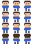
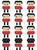
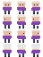
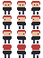
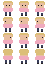
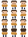
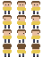
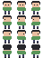
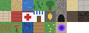

# OpenMon

MMORPG 2D em pixel art jogável no navegador, inspirado nos clássicos jogos de captura de monstros. Todos os gráficos e sons são originais.

## O jogo
- **Mundo compartilhado em tempo real**: vários jogadores andando no mesmo mapa, com cidade, rotas com grama alta, lago, caverna e uma praia com criaturas próprias.
- **151 criaturas** da primeira geração, com golpes, evoluções e versões raras.
- **Batalhas por turnos** com efetividade de tipos, golpes críticos, efeitos de status e adversários controlados pela IA.
- **Captura** com diferentes tipos de bola, **evolução** por nível e aprendizado de golpes.
- **Equipe de até 6**, armazenamento para o restante e **Pokédex** com o que você já viu e capturou.
- **Loja, itens e missões** com recompensas, **ginásio com insígnia** e **Elite dos Quatro**.
- **Chat** global, local e privado, **trocas** entre jogadores e **ranking**.
- Música e efeitos sintetizados no próprio navegador, e controles na tela para celular.

## Personagens

       

## Mapa

---

Este repositório é uma **vitrine** do projeto: mostra o que o jogo é e como ele é. O código-fonte não é público.

Desenvolvido por [@won3er](https://github.com/won3er).